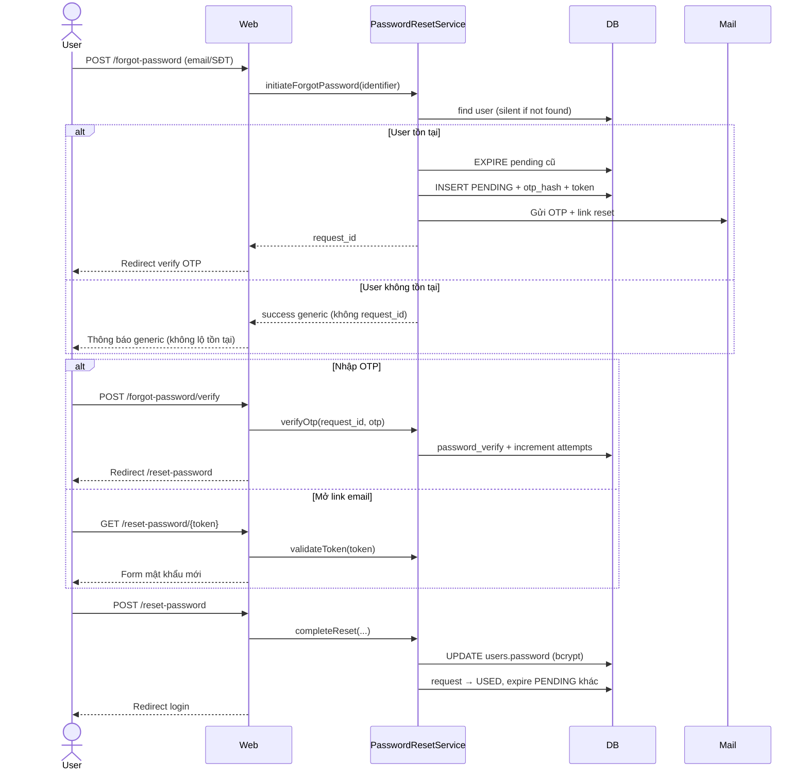
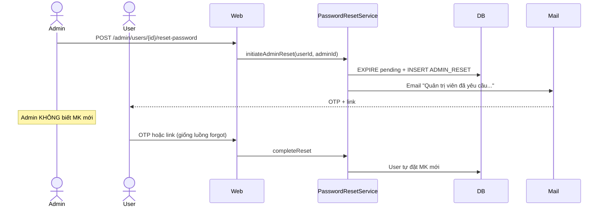

# Password Reset — Thiết kế & Triển khai

Hai luồng đồng thời: **User quên mật khẩu** và **Admin đặt lại mật khẩu**. Admin không bao giờ nhập hoặc biết mật khẩu mới của User.

---

## 1. Database Schema

```sql
CREATE TABLE password_reset_requests (
    id              INT UNSIGNED AUTO_INCREMENT PRIMARY KEY,
    user_id         INT UNSIGNED NOT NULL,
    request_type    ENUM('ADMIN_RESET', 'FORGOT_PASSWORD') NOT NULL,
    otp_hash        VARCHAR(255) NULL,          -- bcrypt/Argon2 hash của OTP
    token           VARCHAR(64) NULL,          -- hex(random_bytes(32))
    status          ENUM('PENDING', 'USED', 'EXPIRED') NOT NULL DEFAULT 'PENDING',
    verify_attempts INT UNSIGNED NOT NULL DEFAULT 0,
    expired_at      DATETIME NOT NULL,         -- hết hạn tổng thể (max OTP/token)
    created_at      DATETIME NOT NULL DEFAULT CURRENT_TIMESTAMP,
    created_by      ENUM('ADMIN', 'USER') NOT NULL,
    created_by_id   INT UNSIGNED NULL,
    KEY prr_user_status (user_id, status),
    KEY prr_token (token),
    UNIQUE KEY prr_token_unique (token),
    CONSTRAINT prr_user_fk FOREIGN KEY (user_id) REFERENCES users(id) ON DELETE CASCADE
);
```

**Migration:** `data/migrate_password_reset.sql` hoặc tự chạy khi app khởi động (`DatabaseMigrator`).

**Quy tắc DB:**
| # | Quy tắc | Cách triển khai |
|---|---------|-----------------|
| 1 | Tối đa 1 request `PENDING`/user | `expirePendingForUser()` trước khi `INSERT` |
| 2 | Request mới → PENDING cũ → EXPIRED | `UPDATE ... SET status=EXPIRED WHERE user_id=? AND status=PENDING` |
| 3 | OTP/token dùng 1 lần | `markUsed()` + kiểm tra `status=PENDING` |
| 4 | Sau đổi MK → USED + expire PENDING còn lại | `completeReset()` |
| 5 | OTP hết hạn 5 phút | `created_at + OTP_EXPIRE_MINUTES` |
| 6 | Token hết hạn 15 phút | `created_at + TOKEN_EXPIRE_MINUTES` |

---

## 2. API Design

### Web Routes

| Method | Path | Mô tả |
|--------|------|-------|
| GET | `/forgot-password` | Form nhập email/SĐT |
| POST | `/forgot-password` | Tạo request `FORGOT_PASSWORD`, gửi email |
| GET | `/forgot-password/verify` | Form nhập OTP |
| POST | `/forgot-password/verify` | Xác thực OTP |
| POST | `/forgot-password/resend` | Gửi lại email |
| GET | `/reset-password` | Form MK mới (sau OTP) |
| GET | `/reset-password/{token}` | Form MK mới (qua link email) |
| POST | `/reset-password` | Hoàn tất đổi MK |
| POST | `/admin/users/{id}/reset-password` | Admin trigger `ADMIN_RESET` |

### REST API

#### `POST /api/password/forgot`
```json
{ "identifier": "user@gmail.com" }
// hoặc { "email": "..." } / { "phone": "09..." }
```
**Response 200** (luôn generic nếu thành công):
```json
{
  "success": true,
  "message": "Nếu tài khoản tồn tại, chúng tôi đã gửi hướng dẫn...",
  "request_id": 42
}
```

#### `POST /api/password/verify-otp`
```json
{ "request_id": 42, "otp": "123456" }
```

#### `POST /api/password/reset`
```json
{ "request_id": 42, "password": "newpass", "password_confirmation": "newpass" }
// hoặc
{ "token": "abc...", "password": "...", "password_confirmation": "..." }
```

#### `POST /api/password/resend`
```json
{ "request_id": 42 }
```

#### `POST /api/admin/users/{id}/reset-password`
Header: `Authorization: Bearer <admin_jwt>`

---

## 3. Sequence Diagram

### Luồng User — Quên mật khẩu



### Luồng Admin — Đặt lại mật khẩu



---

## 4. Backend Service (mẫu)

**File:** `src/PasswordResetService.php`

| Method | Mô tả |
|--------|-------|
| `initiateForgotPassword($identifier)` | User flow, không lộ account exists |
| `initiateAdminReset($userId, $adminId)` | Admin flow |
| `verifyOtp($requestId, $otp)` | Hash verify, giới hạn attempts |
| `validateToken($token)` | Kiểm tra link reset |
| `completeReset($requestId, $password, $token?)` | Đổi MK + mark USED |
| `resend($requestId)` | Tạo request mới, expire cũ |

**Model:** `src/Models/PasswordResetRequest.php`

---

## 5. Frontend Flow

```
[Quên MK]  /forgot-password
    │ nhập email hoặc SĐT
    ▼
[Verify]   /forgot-password/verify  (chỉ khi có request)
    │ nhập OTP  ──────────────┐
    ▼                         │
[Reset MK] /reset-password      │  hoặc click link email
    │ MK + confirm              │
    ▼                         ▼
[Login]    /login         /reset-password/{token}
```

**Admin:** `/admin/users` → nút **Đặt lại MK** → confirm → flash success. Form sửa user **không còn** trường mật khẩu.

---

## 6. Edge Cases

| # | Edge case | Xử lý |
|---|-----------|-------|
| 1 | Email/SĐT không tồn tại | Trả message generic, không tạo request |
| 2 | User gửi quá 5 request/giờ | HTTP 429 / flash error |
| 3 | OTP sai > 5 lần | Request → EXPIRED |
| 4 | OTP hết hạn (5 phút) | Từ chối verify, yêu cầu resend |
| 5 | Token hết hạn (15 phút) | Từ chối link, yêu cầu forgot lại |
| 6 | Request mới khi còn PENDING | PENDING cũ → EXPIRED |
| 7 | Admin reset + User forgot cùng lúc | Request sau cùng thắng, cũ expire |
| 8 | Dùng OTP xong rồi dùng token cùng request | Sau USED, token/OTP đều invalid |
| 9 | Resend quá sớm (< 60s) | Chặn resend |
| 10 | Mail SMTP lỗi | Ghi `storage/logs/otp.log` (dev fallback) |
| 11 | User bị xóa giữa chừng | `completeReset` fail gracefully |
| 12 | CSRF trên form web | `csrf_field()` + verify POST |
| 13 | MK mới < 6 ký tự | Validation từ chối |
| 14 | MK confirm không khớp | Validation từ chối |
| 15 | Admin reset chính mình | Cho phép (admin cũng nhận email) |
| 16 | Race condition 2 tab reset | `markUsed` có điều kiện `status=PENDING` |
| 17 | Enumeration qua timing | Luôn response tương tự khi forgot |
| 18 | OTP plaintext trong DB | Chỉ lưu `password_hash(otp)` |
| 19 | Token đoán được | 64 hex chars = 256-bit entropy |
| 20 | Session hijack reset flow | Kết hợp request_id session + token one-time |

---

## Cấu hình (.env)

```env
PASSWORD_RESET_OTP_EXPIRE_MINUTES=5
PASSWORD_RESET_TOKEN_EXPIRE_MINUTES=15
PASSWORD_RESET_MAX_SEND_PER_HOUR=5
PASSWORD_RESET_MAX_VERIFY_ATTEMPTS=5
PASSWORD_RESET_RESEND_SECONDS=60
```
